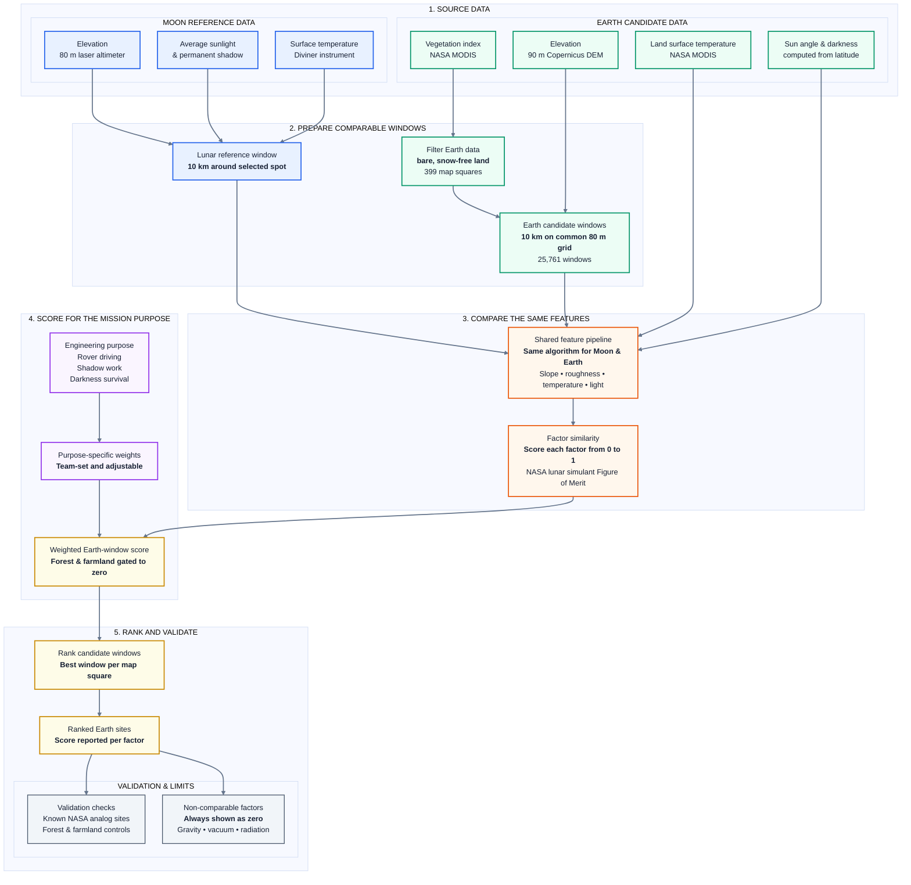

# Matching Architecture

> Sourced from `./Claude outputs/how_matching_works.mermaid`.

> For revisions, edit source diagram '*.mermaid' conanical file directly and copy here.

> The diagram shows how lunar reference data and Earth satellite data are
> normalized, compared, scored, ranked, and validated.

## Visual Key

| Visual | Meaning |
|---|---|
| 🔵 **Blue** | Moon reference data and lunar reference window |
| 🟢 **Green** | Earth candidate data, filtering, and candidate windows |
| 🟠 **Orange** | Shared feature extraction and similarity comparison |
| 🟣 **Purple** | Engineering purpose and adjustable mission weighting |
| 🟡 **Gold** | Weighted scoring, ranking, and final results |
| ⚪ **Gray** | Validation checks and known comparison limitations |
| `──>` **Normal line** | Supporting data or control input |
| `══>` **Heavy line** | Primary processing and scoring pipeline |

> **Reading convention:** Follow the heavy connectors to trace the primary
> matching pipeline. Normal connectors show supporting data and control inputs.



## How to Read the Architecture

The matching process separates **reference data**, **candidate data**, **comparison logic**, and **mission-specific decision logic**.

1. **Moon reference data** defines the lunar environment being matched.
2. **Earth candidate data** identifies locations that can plausibly serve as terrestrial analogs.
3. Both sides enter the **same feature pipeline**, making their derived characteristics directly comparable.
4. Individual factors receive similarity scores from **0 to 1**.
5. The engineering purpose determines the **weights** applied to those factors.
6. Candidate windows receive a weighted score and are **ranked**.
7. The resulting locations are compared with known analog sites and explicit limitations are preserved.

### Primary pipeline

```text
Moon reference ──┐
                 ├══> Shared Feature Pipeline
Earth candidates ┘              ║
                                ▼
                       Factor Similarity
                                ║
                                ▼
Engineering Purpose ──> Weights ══> Weighted Score
                                      ║
                                      ▼
                                    Rank
                                      ║
                                      ▼
                                  Earth Sites
                                      │
                           ┌──────────┴──────────┐
                           ▼                     ▼
                     Validation             Limitations
```